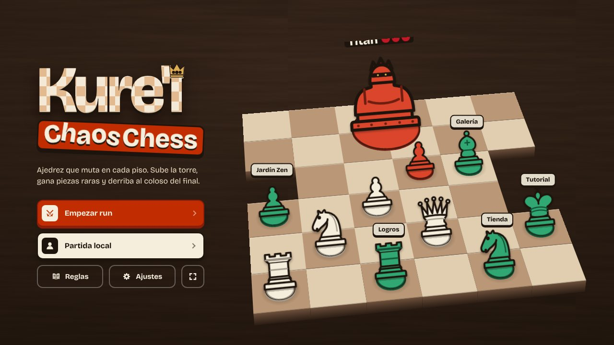
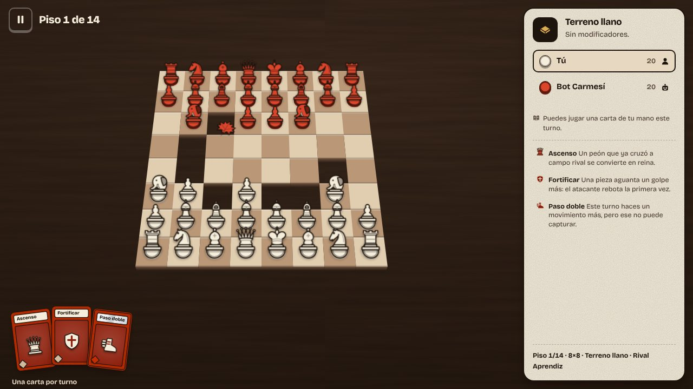
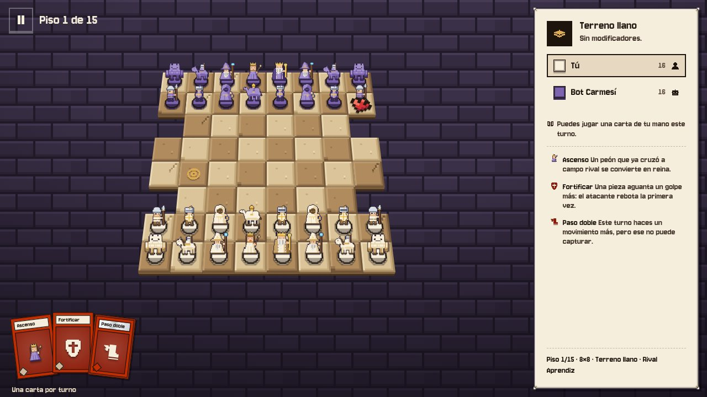
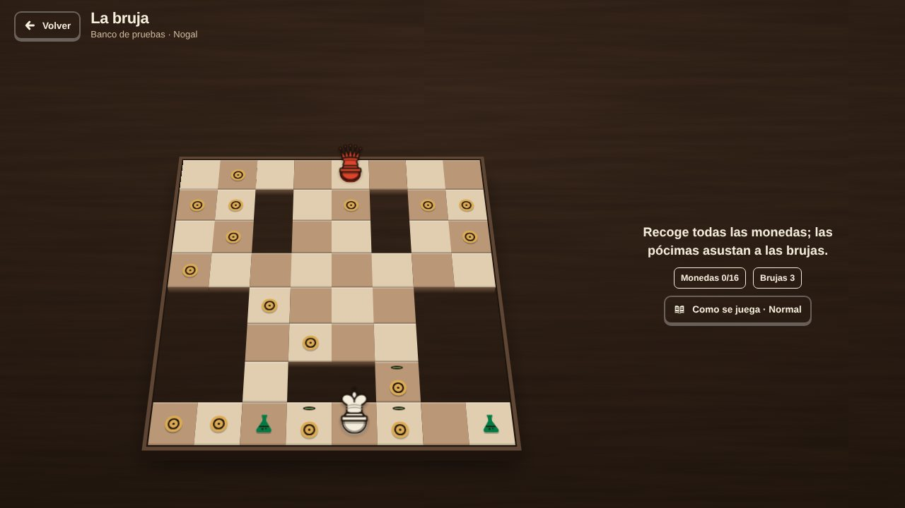
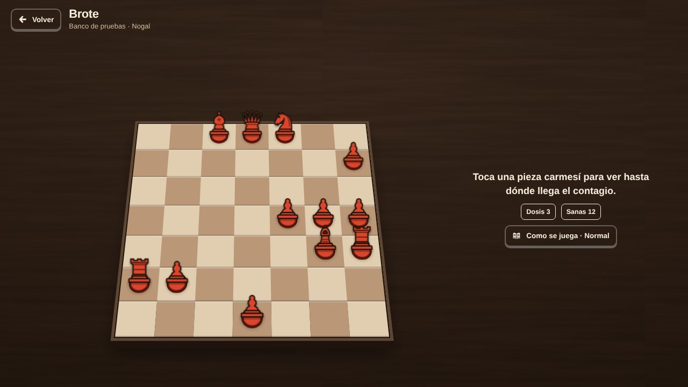
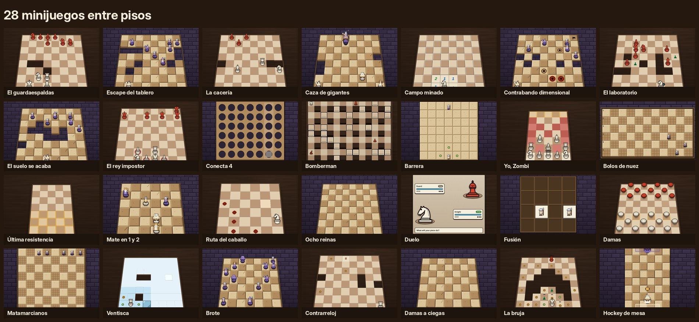
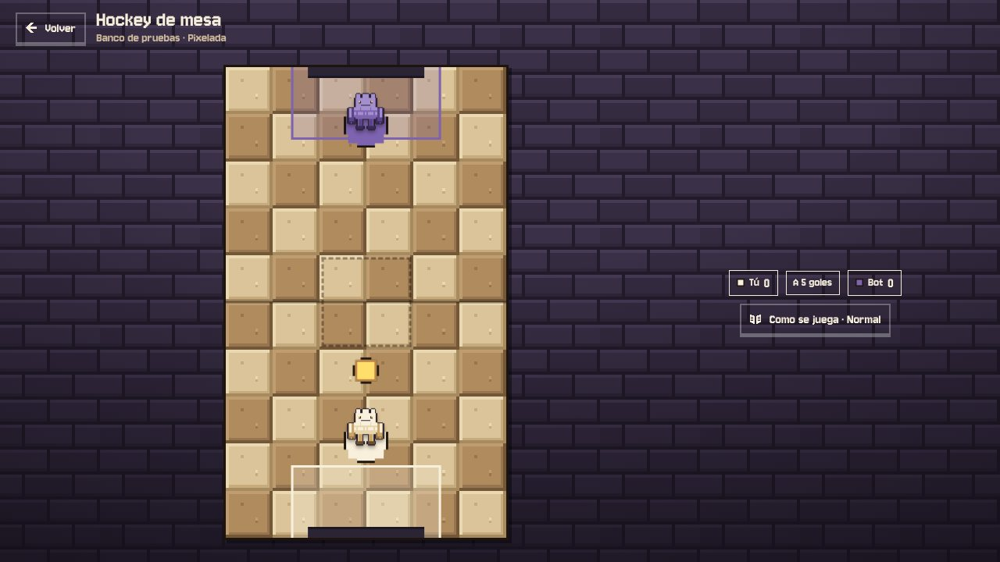
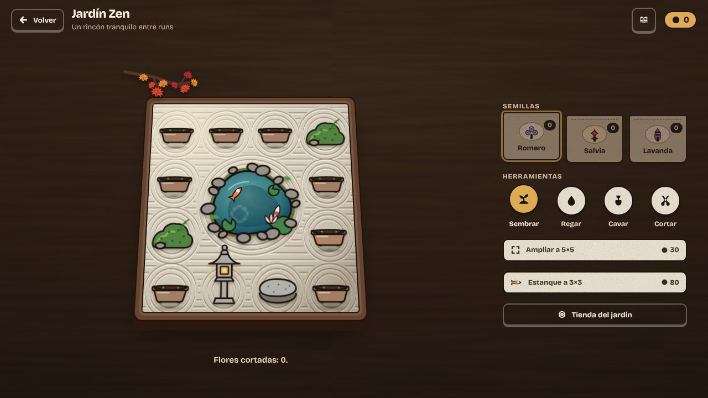
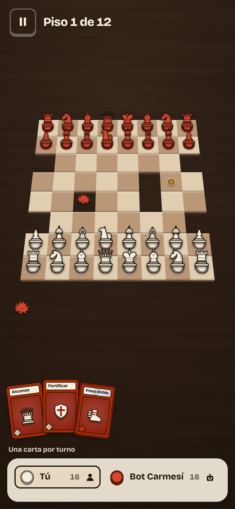

<h1 align="center">Kure'iChaosChess</h1>

<b>Ajedrez que muta en cada piso.</b> 
Sube la torre, gana piezas raras y derriba al coloso del final.

<a href="https://yosoymitxel.github.io/KureiChaosChess/"><b>▶ Jugar gratis en el navegador</b></a> 
Móvil o PC · sin instalar · español e inglés · con mando

## De qué va

Una run es una torre de partidas de ajedrez. En cada piso, las reglas cambian un poco: el tablero
tiene agujeros, el suelo se hiela, una niebla tapa medio campo o empiezan a caer meteoritos. Ganas
capturando al rey enemigo, cobras tu recompensa y eliges por dónde seguir subiendo.

Lo que ganas se queda contigo hasta el final de la run: piezas nuevas, mutaciones que cambian
cómo se mueven las tuyas y cartas tácticas para jugar una por turno. Arriba esperan los jefes:
colosos de varias casillas que aplastan lo que pisan y aguantan varios golpes.

Si caes, vuelves a empezar con otra torre, otros tableros y otras reglas.

| | |
|---|---|
|  |  |

## Qué te espera

- **11 piezas.** Las del ajedrez de siempre y otras raras: la guardia, el camello, el cañón…
- **Mutaciones y cartas.** Una pieza que salta, otra que aguanta un golpe, un peón que da paso doble…
- **7 jefes.** Titán, Ariete, Hidra, el Devorador y más: ocupan 2×2 o 3×3, tienen vidas y te
  devuelven los golpes hasta el último.
- **11 reglas de piso** que se combinan: lago helado, portales, niebla densa, plaga zombi, contagio,
  aquelarre de brujas, lluvia de meteoritos, prisa, élite…
- **28 minijuegos** que salen por el camino y dan premio. Muchos son homenajes a clásicos de NES:

| | |
|---|---|
|  |  |
| **La bruja.** Pac-Man con un rey: recoge las monedas y usa las pócimas para cazar a las brujas. | **Brote.** Como Dr. Mario: con pocas dosis, contagia todo el tablero en cadena. |

  También están damas a ciegas, ventisca, ruta del caballo, el suelo se acaba, matamarcianos y más:

## Para jugar con alguien

**Partida local** en el mismo móvil o PC, uno contra uno. Echa una moneda a cara o cruz para ver
quién empieza y elige:

- **Ajedrez** con el tablero, el tamaño, la forma y la regla de piso que quieras, a una o varias rondas.
- **Minijuegos a dos:** hockey de mesa, conecta 4 y damas.

## Entre run y run

- **Jardín zen.** Siembra, riega y corta flores; amplía el jardín y llena el estanque de kois.
- **Tienda.** Compra mesas nuevas y cosas para el jardín con las monedas de las runs.
- **26 mesas.** 17 son de pixel art y cambian el juego entero: piezas, letra, sonidos y música.
  Hay mesa de gatos, piratas, zombis, marcianitos, Halloween, reino de los hongos…
- **Galería y 68 logros** para ver todo lo que has descubierto.
- **Cuenta opcional.** Sincroniza run, jardín, monedas, mesas y logros entre GitHub Pages e itch.io. Sin cuenta, el juego sigue guardando localmente.

## Cómo se juega

- **Objetivo:** captura el rey enemigo. Si la partida se estanca, gana quien tenga más piezas.
- **Mover:** toca una pieza y luego su destino. Toca una pieza enemiga para ver su alcance en rojo.
- **Cartas:** puedes jugar una por turno; al apuntar, el tablero te enseña cómo quedará.
- **Teclado:** flechas para recorrer el tablero, Enter para elegir y Escape para pausar.
- Valen el enroque y la captura al paso.
- Cada minijuego tiene su botón **«Cómo se juega»** y tres dificultades.

## Créditos

Diseño y desarrollo: [yosoymitxel](https://github.com/yosoymitxel).

- Música: Open Lo-Fi (btahir) y Ninja Adventure (Pixel-boy), CC0.
- Sonidos: Kenney, OpenGameArt y Ninja Adventure, CC0.
- Letras: Bricolage Grotesque y Jersey 10 (SIL OFL).

¿Quieres ver cómo está hecho o añadir algo? Mira la [guía de desarrollo](docs/DESARROLLO.md).
